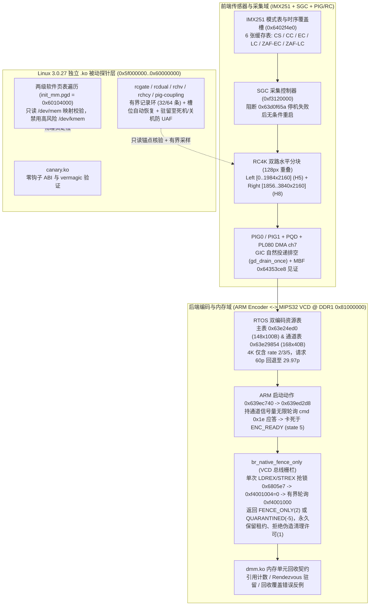

# `a7r3-kernel-video-quarantine` — 索尼 A7R III 内核探针、RTOS 所有权与 4K60 失效隔离研究套件

`a7r3-kernel-video-quarantine` 面向 **Sony Alpha 7R III (`ILCE-7RM3`, FW `3.10`)**，提供 Linux `3.0.27` 零外部符号 `.ko` 被动观测探针、跨 ARM Linux / LiRO RTOS / MIPS32 VCD 编码协处理器的失效关闭隔离（Fail-Closed Quarantine）原语，以及 4K60 视频管线与对焦步进协议的离线原码验证集。

> [!IMPORTANT]
> **净室构建与安全隔离边界**：本仓库不包含任何原厂固件二进制（`av-cam.bin`、`vcd_firmware.bin`、`vmlinux.bin`、`*.ko`、`*.so`）。仓库中的总线栅栏与资源回收门控均定位为离线仿真验证与运行态边界隔离原语（`installable = false`），在完整硬件停机与 DMA 回收链路闭合前不应写入机身持久闪存。

---

## 免责声明

> 大家请以学习为目的使用本仓库⚠️⚠️⚠️⚠️，[安全研究法律边界与合规须知](./DISCLAIMER.md#法规与合规参考)
>
> 本仓库的所有内容仅供学习和参考之用，禁止用于商业用途。任何人或组织不得将本仓库的内容用于非法用途或侵犯他人合法权益。本仓库所涉及的固件分析、系统逆向与硬件接口研究技术仅用于个人合法自有设备上的学习与研究，不得用于未经授权侵入或破坏他人设备、绕过技术保护措施、提取或传播第三方专有固件或其他非法行为。对于因使用本仓库内容而引起的任何法律责任、硬件损坏（变砖）、数据丢失或保修失效，本仓库及作者不承担任何责任。使用本仓库的内容即表示您同意本免责声明的所有条款和条件。
>
> 点击查看更为详细的免责声明。[点击跳转](./DISCLAIMER.md)

---

## 设计概览

在异构相机平台上探索传感器高帧率时序与跨核视频编码管线时，直接修改并重刷闪存中的 Linux 内核映像（`uImage`）或 RTOS 固件极易破坏多核启动链路。本套件将全部内核态观测与硬件边界控制建立在运行态内存之上：内核层采用独立构建、不依赖外部内核符号表的 `.ko` 模块按需动态挂载，通过两级软件页表遍历校验目标物理页并以固定长度环形缓冲采集状态，机身断电后即完全清空，不留任何持久化痕迹。

针对跨核视频管线在超规格参数下容易触发编码器无限轮询挂死及异常清理不彻底的问题，本套件为采集控制器（SGC）、中断控制器（GIC / `liro.ko`）、DMA 通道、VCD 专用总线（`0xf4001000`）与共享内存分配器（`dmm.ko`）构建了显式的状态所有权门控。其中总线栅栏原语 `br_native_fence_only` 通过单次 `LDREX/STREX` 抢占与 `DMB` 内存屏障执行有界停机探测：一旦无法独立证明底层 DMA 与协处理器已完全静默，系统即返回 `FENCE_ONLY` 或 `QUARANTINED` 并永久保留租约，拒绝向未排空的物理页签发释放许可，从而以受控隔离替代不可预测的并发内存踩踏。

套件中的所有时序模型、资源表查询与回收反例均通过无桩指令仿真器（Stub-Free Unicorn）直接驱动原厂 ARM/Thumb 与 MIPS32 指令流完成验证，使算术截断、伪帧计数器与异步邮箱竞态在离线阶段即可得到定量复现。

---

## 一、跨异构域视频管线与失效隔离架构



---

## 二、核心研究结论与关键反例证伪（Stub-Free Unicorn 实证）

本套件坚持**零函数桩（Stub-Free）执行原厂机器码**，通过 Unicorn 直接运行 `av-cam.bin`（ARM/Thumb + VFPv3）、`vcd_firmware.bin`（MIPS32 LE）与 `vmlinux.bin` / `dmm.ko`（ARM32），证伪了多项表面“看似可行”的伪线索：

| 编号 | 领域 | 被证伪的假说 / 表面现象 | 原厂指令级反例证据（对应验证脚本） |
|---|---|---|---|
| 1 | 早期字符串 | `av-cam.bin` 含 `"3840X2160_60_50P"` 代表支持 4K60 录制 | 调用点源自 `dec/sfmc_dec_input_video.cpp`（**视频解码器**属性日志），非传感器或编码器能力 (`focus-bracketing/test_original_focus.py`)。 |
| 2 | 编码资源表 | 仅放开 UI/格式门控 (`libObj.so+0x8fea90` / `0x63f7924b`) 即可编码 | 主表 `0x63e24ed0` 与通道表 `0x63e29854` 中 4K 条目最高仅 H.264 Level 5.1 (`rate 2/3/5`)，请求 `rate 0/1` 会静默回退至 29.97p 行，并在 `0x639ed2d8` 无超时轮询中将状态机永久卡死在 `state 5` (`test_original_tables.py`, `test_encoder_buffer_lookup.py`)。 |
| 3 | MIPS VCD 校验 | MIPS `0x80116378` 参数检查返回 `0` 证明硬件可跑 4K60 | 传入 `Level=255` 与 `TimeScale=0` 同样返回 `0`；且 `0x800dbc24` 在错误管理器状态下**先向邮箱 `0xbf044020` 写入成功 ACK `0x80000000`**，随后才异步抛出 `0x2000` 错误 (`test_vcd_start_validation.py`, `test_vcd_command_ack.py`)。 |
| 4 | IMX251 Mode 19 | Mode 19 半行周期 `H350/V1716` 或半场高 `H700/V858` 可达成 4K60 | 后处理 `0x637a3da8` 计算 `round(1050/H*100) & 0xff` 发生 **8 位无符号截断**（`300 -> 44`, `301 -> 45`）且仍返回 `R0=0`；而 `H700/V858` 在 `0x635ca140` LC 窗口模型中溢出帧预算 `1,394 ticks`（要求 `V >= 1138`）。软件算术仅剩 Mode 76 `H770/V780`（余量 `200 ticks`）与 Mode 19 `H525/V1144`（余量 `22 ticks`）(`test_mode19_candidates.py`, `test_readout_windows.py`)。 |
| 5 | 传感器缓存回滚 | 将覆盖槽 `0x6402f4e0` 清回 `FF` 即可恢复原厂 25p 时序 | 清除槽位后调用 `GetParam(76)`（乃至穿插查询 HD Mode 5）**不会触发 `0x637a6540` 重算**，6 张驻留缓存表仍保持篡改态。必须先写入当期原厂描述符强制重算并核对 6 表，再清回 `FF` (`test_restore_sequence.py`)。 |
| 6 | 伪硬件帧计数器 | `getBrokenFrameCount`、`IRQ11` 计数、`PIG A/B` 事件掩码可作真实出帧证明 | `getBrokenFrameCount` 恒为 `movs r0, #1; bx lr`；`IRQ11` (`0x641fded4`) 对 `fact=0` 亦无条件自增；`PIG A/B` 对任意掩码恒发相同汇总事件 ID `0x44000000`/`0x48000000` (`test_irq11_counter.py`, `test_native_semantics.py`)。 |
| 7 | DMM / VCD 停机回收 | `ImolaStopVcdBus` 或 `dmm_ctrl_FreeUnitHdlr` 返回 `0` 即可安全释放 DMA 内存 | `stop_done` 使用 8 位短键 (`raw+0xa`) 存在 ABA 复用风险；`dmm.ko` 返回 `0` 可能仅递减 `alloc` 引用或保留 `rendezvous` 块，而残留 `open` 引用会释放物理块却返回 `+3`（触发上层误判失败，严禁盲目重试）(`test_dmm_rpc.py`, `test_kernel_free.py`, `test_vcd_bus_fence.py`)。 |
| 8 | 对焦包围步进 | `SET_STEPFOCUS` (`0x4117`) 参数代表毫米级对焦距离或物理马达步数 | `0x63bc13ac` 仅对 `+0x56d` 处的 **8 位软件序号**做加减回绕（`0 - 1 -> 255`, `255 + 1 -> 0`），不具备镜头极性、物理行程或合焦静止证明 (`focus-bracketing/test_original_focus.py`)。 |

---

## 三、目录结构说明

```text
a7r3-kernel-video-quarantine/
├── kernel-probes/                # 独立无外部符号 Linux 3.0.27 (.ko) 诊断探针与内核页表/DMM 工具
│   ├── canary/                   # 零钩子 ABI 与 vermagic 校验模块 (canary.S, build.py)
│   ├── rc-gateway/               # RC4K 双分块/HV 重叠/H5&H8 周期有界探针 + 纯 Python ET_REL 加载重定位器
│   ├── pig-coupling/             # PIG 源耦合观测网关 (gateway.c, pig_bridge.S, table_protocol.c)
│   └── pte-walk-and-dmm/         # vmalloc_to_page 两级页表遍历与 dmm.ko 引用计数反例验证
├── quarantine-gates/             # Fail-Closed 失效关闭隔离原语 (C + ARMv7 汇编)
│   ├── vcd-bus-fence/            # br_native_fence_only: LDREX/STREX 抢锁 + 0xf4001000 有界总线栅栏
│   ├── producer-protocol/        # SGC 停机后防误重启门控、H5/H8 Release 门控与队列等待者见证
│   └── source-reclaim/           # Sony NOAUTOEN 中断门控、LiRO sem26 桥接、GIC 自然排空与 PQD 标记
├── camera-guards/                # 机内只读监控与自主安全守护工具
│   ├── stock-record-guard/       # 原厂录制自主守护 r4 (+0x10c/+0x110/+0x114 三态跟踪与 ENOSPC 保护)
│   ├── stock-preview-guard/      # 不写卡 Mode 76 拨盘 enter 10 / return 6 预览往返守护
│   └── ram-observers/            # VCD DDR1 追踪环、任务 6/10/13/21 状态与 /dev/mem 只读采样器
├── video-4k60-verifiers/         # 参数化 A7R3_FW_ROOT 的 Unicorn 零桩验证器与 FFmpeg 帧重复审计器
├── focus-bracketing/             # 对焦驱动符号扫描、Thumb PIC 交叉引用与 SET_STEPFOCUS 零桩验证
└── tests/                        # 离线宿主机测试套件与全量真机固件验证入口
```

---

## 四、快速测试与验证指南

### 1. 离线宿主机单元测试（无需索尼固件、无需第三方 Python 库）
仅需宿主机 `clang`（原生支持 ASan/UBSan 及 `--target=armv7-linux-gnueabi` 独立目标编译）、标准库 `python3` 与 `ffmpeg`：

```bash
make test
```

`make test` 将执行 5 组完全离线的严格验证：
1. **Stock Record Guard r4 策略机测试**（Clang ASan/UBSan）：验证录制起停单次认领、超时与异常三态门控；
2. **Stock Mode 76 Preview Guard 与拨盘所有权测试**（Clang ASan/UBSan）：验证 `enter 10` / `return 6` 状态转换与故障持锁 (`PO_HOLD`)；
3. **VCD 有界停机契约 `bb_attempt` 测试**（Clang ASan/UBSan）：验证 `BB_FENCE_ONLY(2)` 从不越权返回清理许可 `1`、超时/故障永久保持租约 (`lease_held == 1`) 及禁止重入；
4. **独立 `.ko` 构建器、纯 Python `ET_REL` 重定位器与全量 21 个 C/ASM 隔离门控编译审计**：调用宿主机 `clang --target=armv7-linux-gnueabi` 在临时目录构建 `canary.ko`、`a7r3_rcgate_1101a.ko` 及全部隔离原语，校验 `0x05000000` EABI5 标志、零未定义外部符号、`__this_module` 重定位与 1,584 字节状态环解码器；
5. **合成视频流帧重复审计器测试**：动态生成真实 60p、原生 25p 与 `29.97p -> 59.94p` 插帧重复三组样本，验证 PTS 周期与相邻帧精确哈希去重检测。

### 2. 基于本地只读解包固件的全量 Unicorn 零桩验证（可选）
安装可选依赖（`pip install -r requirements.txt`）并指定本地合法解包的 A7R III `3.10` 文件系统根目录：

```bash
A7R3_FW_ROOT=/path/to/verified-3.10/filesystems make verify-fw
```

`make verify-fw` 会对只读固件依次运行全部 **17 项** ARM/Thumb/VFPv3 与 MIPS32 LE 零桩验证套件（含纯 `av-cam.bin` 原生初始化 IMX251 46 模式表、VCD 邮箱 ACK 顺序、`dmm.ko` 重定位反例、`vmlinux` 页表遍历、`br_native_fence_only` 总线栅栏及 `SET_STEPFOCUS` 步进反例），全程在系统临时目录中进行，不向仓库或固件目录写入任何字节。

### 3. 单独审计实拍视频样本

```bash
python3 video-4k60-verifiers/audit_video_sample.py /path/to/C0001.MP4 \
  --fps 60000/1001 --width 3840 --height 2160 --seconds 6 \
  --output /tmp/c0001-audit.json
```

---

## 五、安全准则与许可证

- **Fail-Closed 隔离准则**：在未独立证明 SGC 停机无重启、GIC/LIRO 中断自然排空、PL080 DMA ch7 `ACTIVE` 位（bit 17）清零、VCD 总线静默及 DMM 全引用归零之前，任何异常分支必须停留在 `QUARANTINED` 持锁隔离态，绝不释放仍在被硬件 DMA 写入的物理页。
- 本项目基于 [MIT License](LICENSE) 开源。
